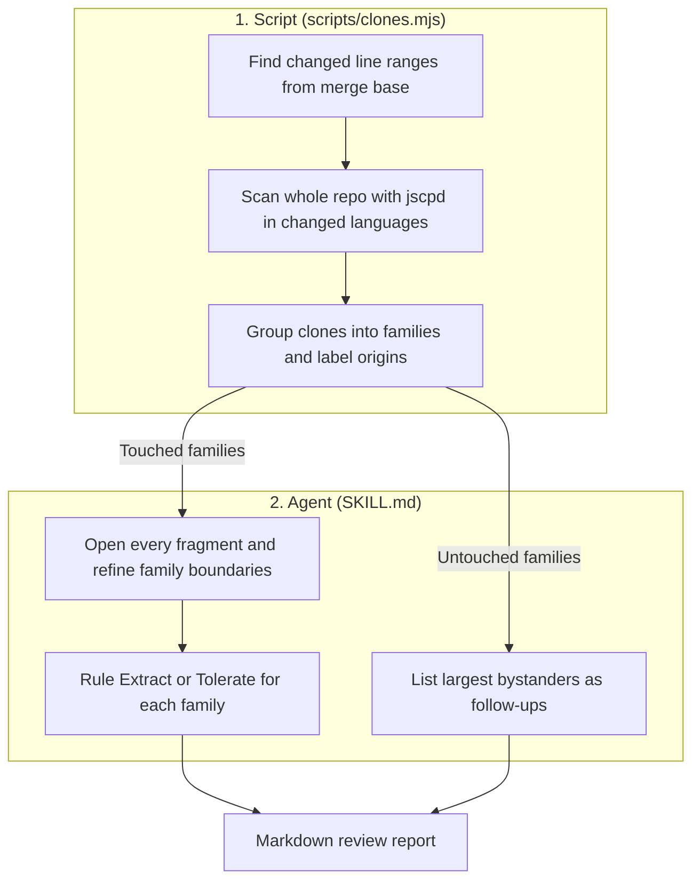

# duplication-review

An agent skill that finds copy/paste clones touching a change and judges each group as a missing abstraction or acceptable repetition.

For every group of clones that overlaps your diff, the agent opens the code and rules **Extract** (naming the missing element and estimating the lines saved) or **Tolerate** (stating why the repetition should stay). The review leaves your files untouched unless you ask the agent to extract.

## Install

Install globally across your projects with [`npx skills`](https://github.com/vercel-labs/skills) (preferred):

```bash
npx skills add xpepper/duplication-review -g
```

Update an existing install with:

```bash
npx skills update duplication-review -g
```

Alternatively, install with the GitHub CLI:

```bash
gh skill install xpepper/duplication-review
```

Both installers pull from `main`.

Requires `git`, Node 22 or later (`node`, `npx`), and `gh` when reviewing a pull request by number.

## Usage

Run `/duplication-review` in an interactive Claude Code or Copilot CLI session. The skill runs only when you invoke it explicitly (`disable-model-invocation: true`). Non-interactive `copilot -p` cannot run it, because that mode does not expand slash commands.

Point it at uncommitted edits, a local branch, or a pull request number. For a pull request, the agent asks before checking out the PR branch and compares against its base branch.

Each family in the report looks like this:

```markdown
### calculateOrderTotal: Extract
Would have made this change easy because: invoice and order totals share the same subtotal, tax, and shipping rules.
Lives in: src/pricing.js · Lines: 24 now, about 14 after (estimate)
- src/invoice.js:1-12 <> src/order.js:1-12 (introduced)
```

When you ask it to extract, the agent puts each extraction in its own refactor-only commit, runs the tests, and re-runs the scan to confirm that the clones are gone.

## How it works

A bundled script handles the mechanical work so every run starts from the same facts, and the agent handles the judgment.



The script scans the whole repository, not just the diff, so it catches new code copied from existing files. It runs [jscpd](https://github.com/kucherenko/jscpd) only in the languages of the changed files, finds copies whose names changed (by syntax tree, and by a second scan with names normalized), honors the repository's own ignore rules and minimum clone sizes, and prints a JSON summary.

The agent opens every fragment in the touched families, merges two families when one element would retire both, or splits one when no single element fits all its fragments. It then rules **Extract** or **Tolerate** on each family and lists the largest untouched families as follow-ups.

Read [How it works](docs/how-it-works.md) for the details on diff scoping, config handling, clone origins, family grouping, and limits.

## Related

Pairs with [code-refactor-review](https://github.com/xpepper/code-refactor-review), which covers the wider review lenses.

## Development

`scripts/clones.mjs` has no runtime dependencies. Run the test suite with:

```bash
node --test 'tests/*.test.mjs'
```

See [Development](docs/development.md) for test prerequisites, CI, bumping the pinned `jscpd` version, and semantic versioning rules.
